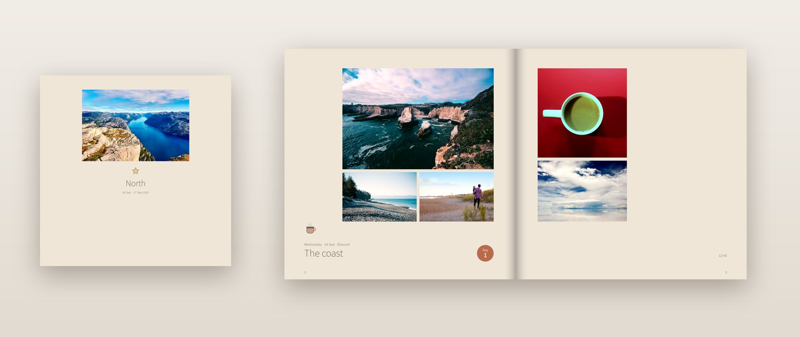
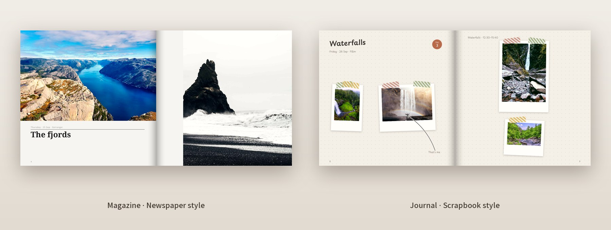
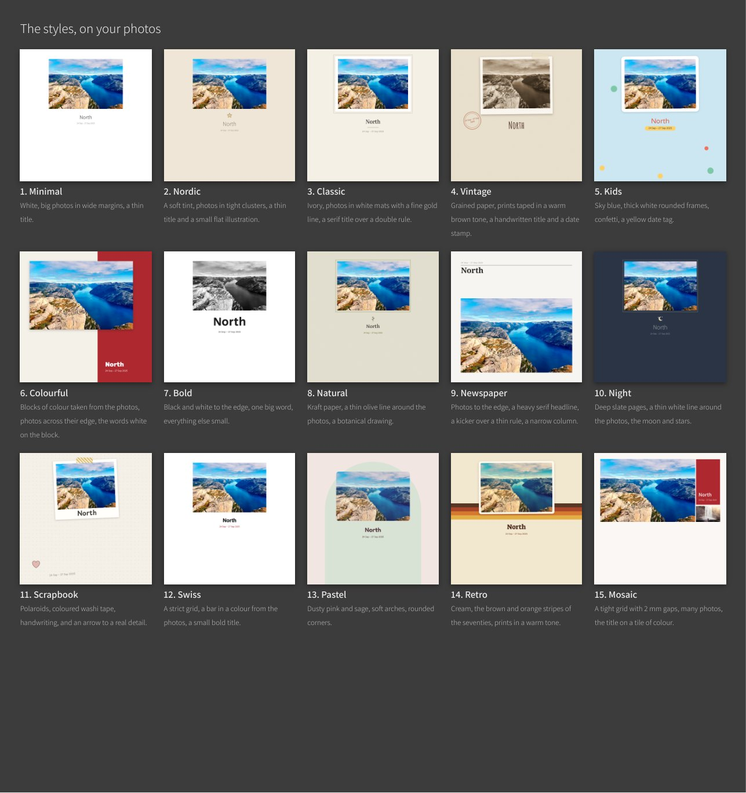
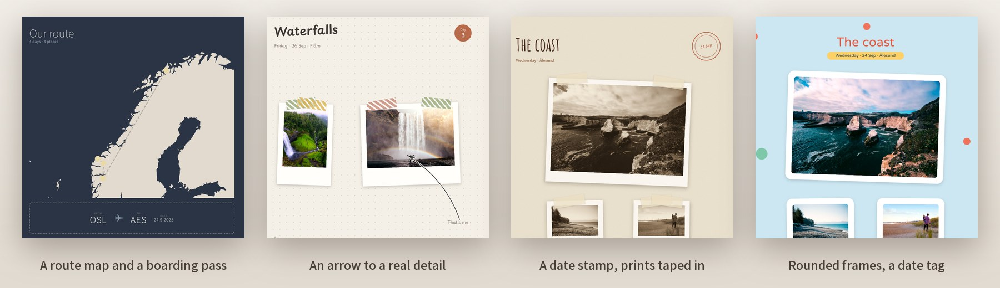
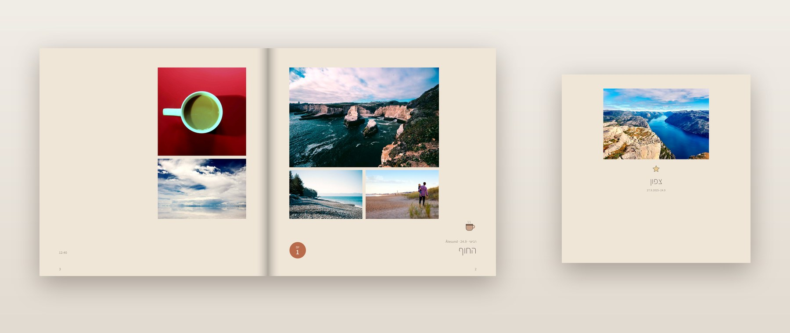

<div align="center">

# Rega – AI Album Maker

**Turn a folder of photos into a print-ready photo book.**
A skill for Claude: you talk, it designs.




</div>

Point it at your photos (a trip, a wedding, a birthday, a baby's first year) and it does the rest: picks the best
frame of each moment, writes short titles from real dates and places, lays out the pages, and checks every page
before you print. You get a PDF and a preview, and, if you like, the file and an order guide for a printer.

> **Beta: this is the first public version.** It already makes real books, and your feedback shapes what comes
> next. Made a book? [Tell us how it went](https://github.com/tamirgur/rega-album-maker/issues/new?template=feedback.yml):
> two lines are plenty. Claude also offers to prepare the note for you when the book is done.



## What it does

- **Sorts the mess.** Goes through thousands of photos from your phone, WhatsApp and camera, and sets aside
  duplicates, blurry shots and screenshots, without deleting anything.
- **Understands what happened.** Finds the days, the places and the moments, then walks through the days with you
  and asks a few light questions. Tell as much as you like.
- **Picks the moments.** The best frame of each moment, and whoever must look their best does.
- **Designs.** 15 styles, from Nordic and Minimal to Scrapbook and Kids, each shown on your own photos first.
- **Adds little things from real facts.** A route map, a boarding pass, stamps, small illustrations of what
  happened, an arrow to a detail in a photo. Nothing is made up.
- **Checks every page.** No face is cut, no title covers anyone, and the page count is exactly what you chose.
- **Writes Hebrew right to left,** English, and other languages.
- **Gets it ready to print.** Square 21 or 30 cm, or A4/A5 portrait, at the printer of your choice. For Prodigi
  it also prepares the file and an order guide, and checks a screenshot of your order before you pay.
- **Keeps it tidy.** Every book in its own folder in "Albums", every version in a new file.

## What it doesn't do

- **Touch your photos.** Nothing is deleted, moved or changed.
- **Upload or pay.** Your photos stay on your computer; only small thumbnails go to the AI, like any image you show
  Claude. You order and pay at the printer yourself.
- **Connect to Google Photos or iCloud directly.** The photos need to be in a folder on your computer.
- **Replace good photos.** A book of phone selfies looks like phone selfies, tidy and well laid out. The more you
  tell it about what happened, the better the book.

## 15 styles

Every style is shown on **your own** photos before you choose.



## Little things, from real facts

A route map, a boarding pass, day badges, stamps, small illustrations of what really happened, and a hand-drawn
arrow to a detail in a photo. Nothing is made up.



## Install

**Claude Code**

```
/plugin marketplace add tamirgur/rega-album-maker
/plugin install rega-album-maker@tamirgur
```

**Cowork** (the Claude desktop app): Customize › Plugins › Add marketplace › `tamirgur/rega-album-maker`, then
install **rega-album-maker**.

Needs Python 3.9+ and Chrome or Edge. Claude checks the computer and offers to install the rest.

**Updates.** Claude Code updates plugins from marketplaces like this one only after you turn it on, once: `/plugin` ›
Marketplaces › tamirgur › Enable auto-update. Either way, Rega tells you when a new version is out.

## Use

> Make a photo book from my Italy trip photos, July 2024.

> תעשה לי אלבום מהטיול ליוון

Claude asks a few short questions along the way, and you can always say "you decide".

## Good to know

- **Nothing is deleted or changed without your explicit yes.** Your photos stay on your computer, never changed,
  moved or uploaded. Claude sees small thumbnails,
  which go to the AI company running it (Anthropic, for Claude). Details: [privacy](skills/rega-album-maker/references/privacy.md).
- **Only what you give it.** It reads only the folders you point it to, and never signs in, uploads or pays on a
  printer's site.
- **Printing is yours.** The skill prepares the file and a step-by-step guide; you order and pay at the printer. We
  take no responsibility for prints or orders and recommend no printer. Prodigi is built in because it ships
  worldwide.

## Talk to us

- 💬 Questions and ideas: [Discussions](https://github.com/tamirgur/rega-album-maker/discussions)
- 🐞 Something didn't work well: [Issues](https://github.com/tamirgur/rega-album-maker/issues). Rega offers to open
  one for you as soon as something goes wrong, with a ready draft and no photos or names in it.
- ⭐ Like it? Star the repo.

---

<div dir="rtl">

## בעברית

> **גרסת בטא: זו הגרסה הציבורית הראשונה.** היא כבר יוצרת ספרים אמיתיים, והפידבק שלכם יקבע מה יגיע הלאה. עשיתם ספר?
> [ספרו לנו איך היה](https://github.com/tamirgur/rega-album-maker/issues/new?template=feedback.yml). שתי שורות מספיקות, ו־Claude גם מציע לנסח את זה בשבילכם בסוף.

**Rega הופך תיקיית תמונות לספר מוכן להדפסה.** נותנים לו תיקייה עם תמונות מטיול, אירוע או שנה עם התינוק,
והוא עושה את השאר בשיחה איתך:

- **מסדר את הבלגן:** עובר על אלפי תמונות מהטלפון, מוואטסאפ ומהמצלמה. מזהה כפולות, תמונות מטושטשות וצילומי מסך
  ומניח אותן בצד, בלי למחוק כלום.
- **מבין מה קרה:** מחלק לימים, למקומות ולרגעים. אחר כך עובר איתך יום־יום ושואל כמה שאלות קלות. מספרים כמה שרוצים.
- **בוחר את הרגעים:** את הפריים הכי טוב מכל רגע, ומי שחייב להיראות הכי טוב יוצא הכי טוב.
- **מעצב:** 15 סגנונות, מנורדי ומינימלי ועד סקרפבוק וילדים. רואים כל סגנון על התמונות שלך לפני שבוחרים.
- **אלמנטים מעובדות אמיתיות:** מפת מסלול, כרטיס טיסה, חותמות, איורים קטנים של מה שקרה, וחץ שמצביע על פרט
  בתמונה. לא ממציא כלום.
- **בודק כל עמוד:** לא חותך פנים, כותרת לא מכסה אף אחד, ומספר העמודים יוצא בדיוק כמו שבחרת.
- **עברית מימין לשמאל,** אנגלית ושפות אחרות.
- **מוכן להדפסה:** ריבוע 21 או 30, או A4/A5 לאורך. בית הדפוס לבחירתך. ל־Prodigi הוא מכין גם קובץ והוראות
  הזמנה, ובודק צילום מסך של ההזמנה לפני שמשלמים. את ההזמנה עושים לבד, והוא לא ממליץ על ספק.
- **שומר מסודר:** כל ספר בתיקייה משלו בתוך "אלבומים", וכל גרסה בקובץ חדש.

**מה הוא לא עושה:**
- **לא נוגע בתמונות שלך:** לא מוחק, לא מזיז ולא משנה.
- **לא מעלה לשום מקום ולא משלם:** התמונות נשארות במחשב. רק תמונות ממוזערות קטנות עוברות ל־AI, כמו כל תמונה שמראים
  ל־Claude.
- **לא מתחבר ישירות לגוגל תמונות או ל־iCloud:** צריך שהתמונות יהיו בתיקייה במחשב.
- **לא מחליף תמונות טובות:** ספר מסלפי בטלפון ייראה כמו ספר מסלפי, רק מסודר ויפה. ככל שמספרים לו יותר על מה שקרה,
  הספר יוצא טוב יותר.

**מה צריך:** Claude Code או Cowork (מנוי Claude), Python וכרום במחשב. הוא בודק ומציע להתקין את מה שחסר.

**משהו לא עבד טוב?** Rega מציע מיד לפתוח Issue, עם טיוטה מוכנה ובלי תמונות או שמות. אפשר גם ישר
ב־[Issues](https://github.com/tamirgur/rega-album-maker/issues).



**התקנה ב־Claude Code:**

</div>

```
/plugin marketplace add tamirgur/rega-album-maker
/plugin install rega-album-maker@tamirgur
```

<div dir="rtl">

**עדכונים:** כדי לקבל גרסאות חדשות אוטומטית, מפעילים פעם אחת: `/plugin` › Marketplaces › tamirgur › Enable auto-update. גם בלי זה, Rega יגיד לך כשיש גרסה חדשה.

**שימוש:** "תעשה לי אלבום מהטיול ליוון".

**כלל ברזל:** שום דבר לא נמחק ולא משתנה בלי אישור מפורש שלך. התמונות המקוריות לא משתנות ולא עולות לשום מקום. אין לנו אחריות על הדפסה או הזמנה, ואנחנו לא ממליצים על ספק.
שאלות ורעיונות ב־[Discussions](https://github.com/tamirgur/rega-album-maker/discussions).

</div>

---

<sub>Made by **Tamir Gur** · MIT license · Sample photos from [Unsplash](https://unsplash.com) via
[Lorem Picsum](https://picsum.photos), by Ales Krivec, Alexey Topolyanskiy, Andrew Coelho, Anna Popović, Annie Spratt,
Danielle MacInnes, Jared Erondu, Jerry Adney, Joseph Barrientos, Justin Leibow, Karl Fredrickson, Matthew Wiebe,
Paul Jarvis, Roberto Nickson, Rosan Harmens, Steve Carter, Susanne Feldt, Vashishtha Jogi and Wolfgang Lutz; the
places in the sample are illustrative.</sub>
